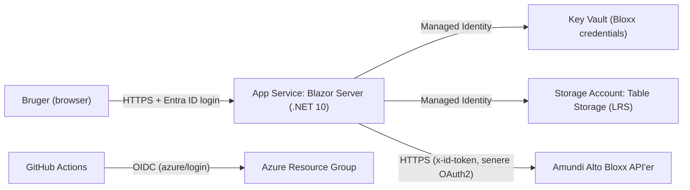

# Plan: Bloxx API Test

Plan for opbygning af en end-to-end løsning til test af API-kald mod **Amundi Alto Bloxx**. Planen følger rammerne i [CLAUDE.md](CLAUDE.md): Azure med lave omkostninger, .NET 10, Blazor Server + MudBlazor, Clean Architecture, Azure Table Storage, Key Vault, Managed Identity og GitHub Actions med OIDC.

> **Afvigelse fra CLAUDE.md:** Log Analytics og dermed Application Insights fravælges for at minimere omkostninger (se afsnit 10).

---

## 1. Mål og afgrænsning

- Webapplikation med titlen **"Bloxx API Test"**, hvor man kan kalde Bloxx API'er og se request/response.
- Sidebar-menu med ét menupunkt pr. API. Første menupunkt: **Client profile**.
- Hvert Bloxx API leverer en `spec.openapi.json`. Den lægges i repo og bruges af Claude til at generere en C#-proxyklasse.
- Kildekode i [github.com/PeterWallenius/ApiTestBloxx](https://github.com/PeterWallenius/ApiTestBloxx).
- To pipelines:
  1. Deployment af Azure-ressourcer (Infrastructure as Code).
  2. Deployment af kode ved commit/merge til `main`.

---

## 2. Arkitektur



### Azure-ressourcer (lav pris)

| Ressource | SKU / opsætning | Formål |
|---|---|---|
| App Service Plan | Linux **F1 (Free)** — 0 kr. | Hosting af Blazor Server |
| Web App | .NET 10, System-assigned Managed Identity, WebSockets **on**, HTTPS only, `/health` endpoint (bruges af smoke test i pipeline) | Applikationen |
| Storage Account | StorageV2, **Standard_LRS**, shared key access **disabled** | Table Storage (testhistorik, gemte requests) |
| Key Vault | Standard, RBAC-model | Bloxx client id/secret, evt. certifikater |

**Begrundelse for App Service frem for Container Apps:** Blazor Server kræver vedvarende SignalR-forbindelser og har lav trafik; App Service F1 er gratis og har simpel drift uden container-registry.

**Forventet omkostning:** App Service er gratis. Kun Storage og Key Vault afregnes efter forbrug, og ved denne trafikmængde bliver det få kroner pr. måned. Der oprettes ingen Log Analytics Workspace, Application Insights eller alert rules.

**Begrænsninger ved F1 (accepteret for et testværktøj):**

| Begrænsning | Konsekvens | Håndtering |
|---|---|---|
| 60 CPU-minutter pr. dag, 1 GB RAM, 1 GB disk | Appen stopper midlertidigt (HTTP 403) ved overskridelse | Tilstrækkeligt til få brugere; følg `CpuTime` under Web App → Metrics i portalen (gratis platform-metrics) |
| Ingen Always On | Appen går i dvale efter ca. 20 min uden trafik; første kald har cold start | Blazor reconnect-UI; smoke test i pipeline med retry |
| Max 5 samtidige WebSocket-forbindelser | Max ca. 5 samtidige Blazor-brugere | Acceptabelt for test; opgradér til B1 ved behov |
| Ingen deployment slots, custom domain eller skalering | Kun `*.azurewebsites.net` | Staging løses evt. med ekstra Web App på samme F1-plan |
| Typisk kun én Free Linux-plan pr. region pr. subscription | Deployment fejler, hvis der allerede findes én | Subscription har allerede en Free Linux-plan i West Europe (whistregnskab) → løsningen placeres i **Denmark East**, hvor F1 Linux er tilgængelig |

Opgradering til B1 kræver kun ændring af SKU-parameteren i `main.bicepparam` og en kørsel af `infra.yml`.

**Staging:** Ingen deployment slots på F1. Anbefaling: start med én Web App. Behov for staging løses med en ekstra Web App på samme F1-plan (stadig 0 kr.). Beslutning tages i fase 6.

### RBAC (mindst privilegium)

| Identitet | Rolle | Scope |
|---|---|---|
| Web App MI | `Storage Table Data Contributor` | Storage Account |
| Web App MI | `Key Vault Secrets User` | Key Vault |
| GitHub OIDC (`sp-github-apitestbloxx`) | `Contributor` + `Role Based Access Control Administrator` (betinget: må kun tildele/fjerne de to roller ovenfor) | Resource Group `rg-apitestbloxx` |

Infra- og app-deployment deler samme service principal; `Contributor` på resource group dækker også deployment af kode.

---

## 3. Repository-struktur

```
ApiTestBloxx/
├─ .github/
│  ├─ workflows/
│  │  ├─ ci.yml                    # Build + test på pull requests
│  │  ├─ infra.yml                 # Pipeline 1: Bicep-deployment af Azure-ressourcer
│  │  └─ deploy-app.yml            # Pipeline 2: Build, test, publish, deploy ved push til main
│  ├─ prompts/
│  │  └─ generate-api-client.prompt.md   # Fast prompt til Claude: spec -> proxyklasse
│  └─ copilot-instructions.md      # Peger på CLAUDE.md + kodekonventioner
├─ ApiSpecs/
│  └─ ClientProfile/
│     └─ spec.openapi.json         # Én underfolder pr. API, filnavn er altid spec.openapi.json
├─ infra/
│  ├─ main.bicep
│  ├─ main.bicepparam
│  └─ modules/
│     ├─ appService.bicep
│     ├─ storage.bicep
│     ├─ keyVault.bicep
│     └─ roleAssignments.bicep
├─ src/
│  ├─ ApiTestBloxx.Domain/         # Entiteter, value objects (fx ApiCallRecord), ingen afhængigheder
│  ├─ ApiTestBloxx.Application/    # Use cases, interfaces (IApiCallHistoryRepository, IBloxxApiCatalog), DTO'er
│  ├─ ApiTestBloxx.Infrastructure/
│  │  ├─ ApiClients/               # Genererede proxyklasser: <ApiNavn>.cs
│  │  │  └─ ClientProfile.cs
│  │  ├─ Authentication/           # DelegatingHandler: x-id-token (nu), OAuth2 client credentials (senere)
│  │  ├─ Persistence/              # Table Storage repositories (Azure.Data.Tables)
│  │  └─ DependencyInjection.cs
│  └─ ApiTestBloxx.Web/            # Blazor Server + MudBlazor (Presentation)
│     ├─ Components/
│     │  ├─ Layout/MainLayout.razor
│     │  ├─ Layout/NavMenu.razor
│     │  ├─ Pages/Home.razor
│     │  ├─ Pages/Apis/ClientProfilePage.razor
│     │  └─ Shared/ (RequestEditor, ResponseViewer, CallHistory)
│     └─ Program.cs
├─ tests/
│  ├─ ApiTestBloxx.Domain.Tests/
│  ├─ ApiTestBloxx.Application.Tests/
│  └─ ApiTestBloxx.Infrastructure.IntegrationTests/   # Mod Azurite + mocked Bloxx (WireMock.Net)
├─ docs/
│  └─ runbooks/ (deployment.md, rollback.md, fejlscenarier.md)
├─ Directory.Build.props          # Nullable, ImplicitUsings, TreatWarningsAsErrors, analyzers
├─ Directory.Packages.props       # Central Package Management med pinnede versioner
├─ global.json                    # Pinner .NET 10 SDK
├─ ApiTestBloxx.slnx
├─ CLAUDE.md
├─ Plan.md
└─ README.md
```

---

## 4. API-specs og generering af proxyklasser

### Konvention

| Element | Regel | Eksempel |
|---|---|---|
| API-visningsnavn | Navnet som i Bloxx | `Client profile` |
| Folder i `ApiSpecs/` | PascalCase, ingen mellemrum | `ApiSpecs/ClientProfile/` |
| Spec-fil | Altid `spec.openapi.json` | `ApiSpecs/ClientProfile/spec.openapi.json` |
| Proxyfil | `src/ApiTestBloxx.Infrastructure/ApiClients/<ApiNavn>.cs` | `ClientProfile.cs` |
| Namespace | `ApiTestBloxx.Infrastructure.ApiClients.<ApiNavn>` | `...ApiClients.ClientProfile` |
| Klasse / interface | `<ApiNavn>Client` / `I<ApiNavn>Client` | `ClientProfileClient`, `IClientProfileClient` |

Interfacet placeres i samme fil (én fil pr. API), så hele API'et er samlet i `<ApiNavn>.cs`.

### Krav til den genererede proxyklasse (input til Claude)

Prompten i `.github/prompts/generate-api-client.prompt.md` skal sikre, at Claude genererer ensartet kode:

- Input: `ApiSpecs/<ApiNavn>/spec.openapi.json`. Output: `src/ApiTestBloxx.Infrastructure/ApiClients/<ApiNavn>.cs`.
- Én metode pr. operation (`operationId` → `PascalCase` + `Async`), med `CancellationToken`.
- Typed `HttpClient` injiceres via constructor (registreres med `AddHttpClient<IXxxClient, XxxClient>()`); ingen `new HttpClient()`.
- Request/response-modeller som `sealed record` med `System.Text.Json` attributter (`[JsonPropertyName]`), nullable reference types respekteret.
- Ingen hardcodede base-URL'er, tokens eller secrets; base-URL kommer fra `IOptions<BloxxApiOptions>`.
- Fejl: ikke-2xx svar kastes som `BloxxApiException` med statuskode og rå response body (så UI kan vise den).
- Rå request/response (headers, body, varighed) skal kunne opsamles til UI via en fælles `DelegatingHandler` frem for i hver proxy.
- Header-kommentar i filen: `// <auto-generated>` + spec-version (`info.version`) + SHA-256 hash af spec-filen, så det kan ses om proxyen er forældet.
- Koden skal bygge uden warnings.

### Arbejdsgang for nyt API

1. Hent `spec.openapi.json` fra Bloxx og læg den i `ApiSpecs/<ApiNavn>/`.
2. Kør prompten `generate-api-client` i Copilot Chat / Claude med `<ApiNavn>` som argument.
3. Registrér klienten i `Infrastructure/DependencyInjection.cs`.
4. Tilføj side under `Web/Components/Pages/Apis/<ApiNavn>Page.razor` og menupunkt i `NavMenu.razor`.
5. Tilføj enhedstest for serialisering af mindst én request/response.
6. PR → review → merge.

**CI-tjek:** `ci.yml` validerer at hver folder i `ApiSpecs/` har en matchende `ApiClients/<ApiNavn>.cs`, og at hashen i proxy-headeren matcher spec-filen (fejler PR hvis spec er ændret uden regenerering).

---

## 5. Blazor frontend

- **Blazor Server** (Interactive Server render mode) med **MudBlazor**.
- `MainLayout.razor`: `MudLayout` med `MudAppBar` (titel **"Bloxx API Test"**, burger-knap til drawer) og `MudDrawer` som sidebar.
- `NavMenu.razor`: `MudNavMenu` med:
  1. **Client profile** → `/apis/client-profile`
  2. (Kommende API'er tilføjes nedenunder)
- `ClientProfilePage.razor`:
  - Liste over operationer i API'et (fra proxy/spec).
  - Formular til parametre (path/query/body) med inputvalidering.
  - Knap "Send" → kalder proxy via Application-laget.
  - `ResponseViewer`: statuskode, varighed, headers, formateret JSON (output encoding via Razor, ingen `MarkupString` med rå data).
  - `CallHistory`: seneste kald for brugeren hentet fra Table Storage.
- Valg af Bloxx-miljø (fx test/prod) via dropdown, hvis flere miljøer er relevante — konfigureres i `BloxxApiOptions`.
- Brugerlogin til selve appen: **App Service Authentication (Easy Auth) med Entra ID** — ingen ekstra kode og ingen ekstra omkostning.

---

## 6. Data i Azure Table Storage

| Tabel | PartitionKey | RowKey | Indhold |
|---|---|---|---|
| `ApiCallHistory` | `<ApiNavn>` | Omvendt tidsstempel + GUID (nyeste først) | Operation, bruger, statuskode, varighed, trunkeret request/response (< 64 KB pr. property) |
| `SavedRequests` | `<Bruger-id>` | `<ApiNavn>_<navn>` | Gemte request-skabeloner |

- Adgang via `TableServiceClient` + `DefaultAzureCredential` (Managed Identity i Azure, Azure CLI-login lokalt).
- Lokalt og i integrationstests: **Azurite**.
- Følsomme data (`x-id-token`, tokens, Authorization-headers) maskeres før lagring.

---

## 7. Konfiguration og hemmeligheder

- `BloxxApiOptions` (sektion `BloxxApi`, IOptions, valideret med `ValidateDataAnnotations().ValidateOnStart()`): `BaseUrl`, `AuthMode` (`ApiKey` | `OAuth2`).
- **Autentifikation — nu (`ApiKey`):** Bloxx kræver headeren `x-id-token` med en fast nøgle. Nøglen ligger kun i **Key Vault** som secret `BloxxApi--IdToken` (`--` bliver til `:` → `BloxxApi:IdToken`) og indlæses via `AddAzureKeyVault(...)` med `DefaultAzureCredential`.
- **Autentifikation — senere (`OAuth2`, når sandbox er tilgængelig):** tilføj `TokenUrl`, `ClientId`, `Scope` til `BloxxApiOptions` og secret `BloxxApi--ClientSecret` i Key Vault. Handleren henter token (client credentials), cacher det til udløb og sætter det på kaldet. Skift sker via `AuthMode`; proxyklasserne er upåvirkede.
- Headerværdien maskeres i historik og UI (se afsnit 6).
- Lokal udvikling: `dotnet user-secrets` — aldrig secrets i `appsettings*.json` eller i repo.
- App settings i Web App sættes af Bicep (Key Vault URI, Storage endpoint).

---

## 8. GitHub repository og secrets

### Repository

- Repository findes: `PeterWallenius/ApiTestBloxx` (**public**, branch `main`). Den lokale workspace `BloxxApiClient` er klonet herfra (`origin`).
- Da repoet er public, må der aldrig committes secrets, Bloxx-URL'er med nøgler, tenant-specifikke værdier eller rigtige API-svar med kundedata. `spec.openapi.json`-filer skal tjekkes for interne oplysninger, før de committes.
- Branch protection på `main`: PR påkrævet, `ci.yml` skal være grøn, ingen force push. (Gratis for public repos; krav om review giver kun mening med flere udviklere.)

### Entra ID / OIDC-opsætning (udført)

| Element | Værdi |
|---|---|
| Subscription | `Pay-As-You-Go-PW` (privat tenant) |
| Resource group | `rg-apitestbloxx` (Denmark East) |
| App Registration / Service Principal | `sp-github-apitestbloxx` |
| Federated credential `github-main` | `repo:PeterWallenius@<owner-id>/ApiTestBloxx@<repo-id>:ref:refs/heads/main` |
| Federated credential `github-env-production` | `repo:PeterWallenius@<owner-id>/ApiTestBloxx@<repo-id>:environment:production` |
| Roller | Se afsnit 2 (RBAC) |
| GitHub environment | `production` |

GitHub udsteder OIDC-subject med immutable owner-/repo-ID'er (`owner@id/repo@id`). Det simple format `repo:owner/repo:...` giver `AADSTS700213`. Det præcise subject kan ses i fejlbeskeden fra `azure/login`. Subject matches case-sensitivt. Jobs der logger ind i Azure skal enten køre på `main` uden environment eller med `environment: production` — andre kombinationer (fx pull requests) får ikke adgang.

### Repository secrets og variables (oprettet)

IDs står ikke her, da repoet er public. Se dem med `gh secret list` / `az ad sp show`. Opdatéres med `gh secret set <NAVN> --repo PeterWallenius/ApiTestBloxx`.

| Secret | Værdi | Bruges i |
|---|---|---|
| `AZURE_CLIENT_ID` | Client ID for `sp-github-apitestbloxx` | `infra.yml`, `deploy-app.yml` |
| `AZURE_SUBSCRIPTION_ID` | Subscription ID for `Pay-As-You-Go-PW` | `infra.yml`, `deploy-app.yml` |
| `AZURE_TENANT_ID` | Tenant ID | `infra.yml`, `deploy-app.yml` |
| `AZURE_WEBAPP_NAME` | `app-apitestbloxx` (navn verificeret ledigt) | `infra.yml` (parameter til Bicep), `deploy-app.yml` |

| Variable | Værdi |
|---|---|
| `AZURE_RESOURCE_GROUP` | `rg-apitestbloxx` |
| `AZURE_LOCATION` | `denmarkeast` |

---

## 9. Pipelines (GitHub Actions)

Fælles: `permissions: id-token: write, contents: read`, `azure/login@v2` med de tre OIDC-secrets, actions pinnet til version/SHA, `concurrency` for at undgå parallelle deploys.

### `ci.yml` — Pull requests

Trigger: `pull_request` mod `main`.

1. Checkout
2. `actions/setup-dotnet` (version fra `global.json`)
3. `dotnet restore --locked-mode`
4. `dotnet build -c Release` (warnings as errors)
5. `dotnet test` (unit + integration med Azurite som service container)
6. Tjek af ApiSpecs ↔ ApiClients (afsnit 4)
7. `az bicep build` + `az deployment group what-if` (kun visning) for ændringer i `infra/**`

### Pipeline 1: `infra.yml` — Azure-ressourcer

Trigger: `workflow_dispatch` + `push` til `main` med `paths: infra/**`.

1. Checkout
2. `azure/login@v2` (OIDC)
3. `az deployment group validate`
4. `az deployment group what-if`
5. `az deployment group create` med `main.bicep` og `webAppName=${{ secrets.AZURE_WEBAPP_NAME }}`
6. Output: Web App URL, Key Vault navn

Bicep er idempotent, så pipelinen kan køres igen uden sideeffekter.

### Pipeline 2: `deploy-app.yml` — Kode ved commit til `main`

Trigger: `push` til `main` med `paths: src/**, tests/**, ApiSpecs/**, Directory.*.props, global.json` + `workflow_dispatch`.

1. **build-test job:** checkout → setup-dotnet → restore → build → test → `dotnet publish src/ApiTestBloxx.Web -c Release -o publish` → upload artifact (navngivet med `github.sha` for rollback).
2. **deploy job** (`environment: production`, evt. med manuel godkendelse):
   - download artifact
   - `azure/login@v2` (OIDC)
   - `azure/webapps-deploy@v3` med `app-name: ${{ secrets.AZURE_WEBAPP_NAME }}`
   - Smoke test: `curl` mod `https://<app>/health` med retry; fejler jobbet ved non-200.

### Rollback

- Kør `deploy-app.yml` via `workflow_dispatch` med input `artifact-run-id` for en tidligere grøn kørsel, eller revert commit på `main`.
- Artifact retention: 30 dage.

---

## 10. Observability

Log Analytics slås fra for at minimere omkostninger. Da nye Application Insights-ressourcer altid kræver en Log Analytics Workspace, fravælges Application Insights også. Observability løses med gratis indbyggede funktioner:

- **Applikationslogs:** `ILogger` til console; App Service-logs slås til med filesystem-lagring (kvote fx 35 MB, retention 3 dage) via Bicep. Læses med Log stream i portalen eller `az webapp log tail`.
- **Logniveauer:** `Warning`+ for framework, `Information` for egen kode.
- **Platform-metrics** (gratis, 93 dages historik): HTTP 5xx, responstid, `CpuTime`, hukommelse — ses under Web App → Metrics.
- **Bloxx-kald:** statuskode, varighed og maskeret request/response gemmes i Table Storage-tabellen `ApiCallHistory` (afsnit 6) og fungerer som audit-log.
- **Deployment-fejl:** fanges af smoke test mod `/health` i `deploy-app.yml`.
- **Ingen alert rules** (de koster pr. signal). Kan tilføjes senere som metric alerts uden Log Analytics.
- Koden forberedes, så Application Insights kan slås til senere alene via app setting `APPLICATIONINSIGHTS_CONNECTION_STRING` (OpenTelemetry-exporter registreres kun, hvis den er sat).

---

## 11. Test og kvalitet

- **Unit tests** (xUnit): domænelogik, maskering af følsomme data, serialisering af proxy-modeller.
- **Integrationstests**: Table Storage-repositories mod Azurite; proxyklasser mod WireMock.Net-stubs baseret på `spec.openapi.json`.
- **Statisk analyse**: .NET analyzers (`AnalysisLevel=latest-recommended`), `dotnet format --verify-no-changes` i CI, Dependabot for NuGet og GitHub Actions.
- Code review påkrævet via branch protection.

---

## 12. Faser og leverancer

### Fase 0 — Forudsætninger
- [x] Afklar Bloxx-autentifikation: fast nøgle i headeren `x-id-token` nu; OAuth2 når sandbox er tilgængelig.
- [ ] Afklar Bloxx miljø-URL'er.
- [ ] Hent `spec.openapi.json` for **Client profile**.
- [x] Azure subscription (`Pay-As-You-Go-PW`), region (Denmark East) og resource group (`rg-apitestbloxx`).
- [x] Free Linux App Service Plan findes allerede i West Europe → Denmark East valgt (F1 Linux verificeret tilgængelig).

### Fase 1 — Repository og skelet
- [x] Repository `PeterWallenius/ApiTestBloxx` oprettet og klonet lokalt.
- [ ] Commit og push `CLAUDE.md`, `Plan.md`.
- [x] Opret solution med Clean Architecture-projekter og testprojekter.
- [x] `global.json`, `Directory.Build.props`, `Directory.Packages.props` (pinnede versioner + lock files), `.gitignore`, `.editorconfig`.
- [ ] Branch protection på `main`.

### Fase 2 — Azure-fundament og OIDC
- [x] App Registration `sp-github-apitestbloxx` + federated credentials (`main`, environment `production`).
- [x] Resource group + rolletildelinger (Contributor + betinget RBAC Administrator).
- [x] Secrets: `AZURE_CLIENT_ID`, `AZURE_SUBSCRIPTION_ID`, `AZURE_TENANT_ID`, `AZURE_WEBAPP_NAME`; variables: `AZURE_RESOURCE_GROUP`, `AZURE_LOCATION`.
- [x] GitHub environment `production`.
- [x] Bicep-moduler (App Service inkl. filesystem-logs, Storage, Key Vault, RBAC) — valideret med `what-if` (12 ressourcer).
- [x] `infra.yml` (validate → what-if → deploy).
- [x] Første kørsel af `infra.yml` (ved push til `main`).
- [ ] Giv udvikleren `Key Vault Secrets Officer` på Key Vault (manuelt).

### Fase 3 — API-spec og proxy
- [ ] `ApiSpecs/ClientProfile/spec.openapi.json`.
- [ ] `.github/prompts/generate-api-client.prompt.md`.
- [ ] Generér `src/ApiTestBloxx.Infrastructure/ApiClients/ClientProfile.cs`.
- [ ] Læg `BloxxApi--IdToken` i Key Vault (manuelt).
- [ ] Bloxx auth-`DelegatingHandler` (`x-id-token`), logging-handler, DI-registrering.
- [ ] Senere: OAuth2-variant af auth-handleren (token-cache) når sandbox er klar.
- [ ] Tests mod WireMock.Net.

### Fase 4 — Blazor frontend
- [x] MudBlazor-opsætning, `MainLayout` med AppBar "Bloxx API Test" og sidebar-drawer.
- [x] `NavMenu` med **Client profile** som første menupunkt (side er placeholder indtil fase 3).
- [ ] `ClientProfilePage` med request-editor, response-viewer og historik.
- [x] `/health` endpoint.

### Fase 5 — Persistens
- [ ] Table Storage-repositories (`ApiCallHistory`, `SavedRequests`) med Managed Identity.
- [ ] Integrationstests mod Azurite.

### Fase 6 — CI/CD
- [ ] `ci.yml` for PR.
- [ ] `deploy-app.yml` ved push til `main` med smoke test.
- [ ] GitHub environment `production` (evt. manuel godkendelse).
- [ ] Beslutning om staging (ekstra Web App på samme F1-plan eller ingen staging).
- [ ] Easy Auth (Entra ID) aktiveret på Web App via Bicep.

### Fase 7 — Drift og dokumentation
- [ ] README: struktur, lokal opstart (Azurite, user-secrets), build og deploy.
- [ ] Runbooks: deployment, rollback, almindelige fejl (Bloxx 401/403, Key Vault-adgang, Storage-throttling).

---

## 13. Åbne spørgsmål

1. ~~Hvordan autentificeres mod Bloxx?~~ Fast nøgle i `x-id-token` nu, OAuth2 senere (afklaret). Er der IP-whitelisting, der kræver fast udgående IP?
2. Skal der testes mod flere Bloxx-miljøer (test/prod) fra samme app?
3. Hvem skal have adgang til appen (Entra ID-gruppe)?
4. Er staging-miljø nødvendigt fra start, eller er én produktions-Web App tilstrækkeligt?
5. ~~Foretrukken Azure-region?~~ Denmark East (afklaret).
6. Er F1-begrænsningerne (max ca. 5 samtidige brugere, cold start, 60 CPU-min/dag) acceptable, eller skal B1 bruges fra start?
